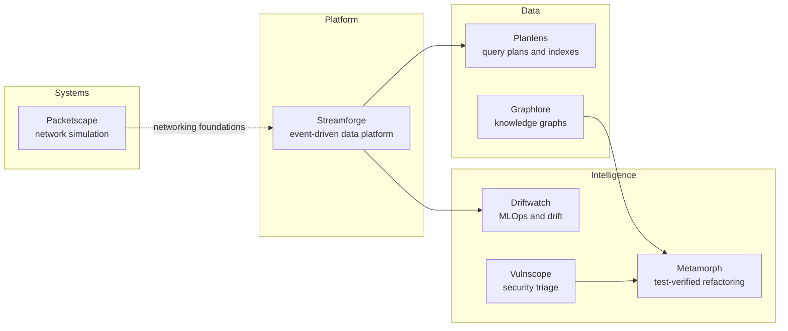

<h1 align="center">Praneetha Potharaju</h1>

  <b>Cloud &amp; DevOps engineer building reliable, observable, data-intensive systems.</b> 
  Applying AI to software quality and security.

  
  
  

---

## What I do

I'm a Software Engineer at **HSBC** (Cloud & DevOps, Hyderabad). My day job is infrastructure as code on **GCP with Terraform**, CI/CD pipelines, and the platform side of process-mining and modelling tools. I have also contributed to AI use cases that help remediate vulnerabilities found by open-source and static-analysis scans.

My side projects ask one question from different angles:

> **How do you build systems that handle data and AI, and that you can still trust?**

That means schemas at the edge, idempotent processing, tests as the arbiter, and no number without a run behind it.

## How the projects fit together

## Projects

| Project | What it is | Stack |
|---|---|---|
| [**Streamforge**](https://github.com/Praneetha1844/Streamforge) | Event-driven data platform: schema-validated ingestion, idempotent at-least-once processing, dead-letter replay, data-quality rules, observability, Terraform for GCP | Python, FastAPI, PostgreSQL, Pub/Sub, Terraform, Docker, Prometheus |
| [**Metamorph**](https://github.com/Praneetha1844/Metamorph) | Refactoring assistant that accepts an LLM refactor **only if the original tests still pass** | Python, FastAPI, React, pytest, radon |
| [**Planlens**](https://github.com/Praneetha1844/Planlens) | PostgreSQL `EXPLAIN` analyser with anti-pattern detectors and a heuristic index advisor | Python, PostgreSQL |
| [**Vulnscope**](https://github.com/Praneetha1844/Vulnscope) | Triage for SAST and dependency findings. Remediation suggestions need human review | Python, SARIF, OSV, SQLite |
| [**Driftwatch**](https://github.com/Praneetha1844/Driftwatch) | MLOps loop: train, gate promotion, serve, detect drift (PSI/KS), retrain | Python, scikit-learn, FastAPI, MLflow |
| [**Graphlore**](https://github.com/Praneetha1844/Graphlore) | Knowledge graphs where every edge cites its source; bounded multi-hop answers or abstains | Python, NetworkX, Neo4j, spaCy |
| [**Packetscape**](https://github.com/Praneetha1844/Packetscape) | Discrete-event network simulator for congestion control and queueing | Python |

Also here: [ReelForge](https://github.com/Praneetha1844/ReelForge) (full-stack short-video app), [Lumigram](https://github.com/Praneetha1844/Lumigram) (React social feed), [Orbitfolio](https://github.com/Praneetha1844/Orbitfolio), [ShuntCalc](https://github.com/Praneetha1844/ShuntCalc) (shunting-yard calculator), [WingDash](https://github.com/Praneetha1844/WingDash), [Gridlock](https://github.com/Praneetha1844/Gridlock), and small ML notebooks [VoxMood](https://github.com/Praneetha1844/VoxMood), [InkSense](https://github.com/Praneetha1844/InkSense), [Mailsieve](https://github.com/Praneetha1844/Mailsieve).

## How I work

- **Tests are the oracle.** A change is trusted when the checks that define correct behaviour still pass.
- **Honest status.** Every project README says what it does, what it doesn't, and which numbers are published. If a result isn't backed by a run, it isn't in the README.
- **Design before code.** Architecture diagrams and short decision records explain the trade-offs, not just the outcome.
- **Boring where it counts.** Idempotent writes, least-privilege IAM, structured logs and metrics.

## Toolbox

## Beyond code

- Organised the **first TEDx event at ACE Engineering College** (500+ attendees, a 30-member team).
- **2nd place**, all-India UiPath Skill-A-thon bot-building contest (2,000+ participants), featured in Times of India. Organised UiPath Hack-A-Bot as a Student Developer Champion.
- Mentored **500+ students** on data structures and algorithms.
- **CCNA** certified in enterprise networking, security and automation, and a diploma in embedded systems.

## Say hello

If you work on data platforms, MLOps, developer tooling or AI for software quality, I'd enjoy hearing from you: [praneetha1844@gmail.com](mailto:praneetha1844@gmail.com) or [LinkedIn](https://www.linkedin.com/in/praneetha-potharaju/).
